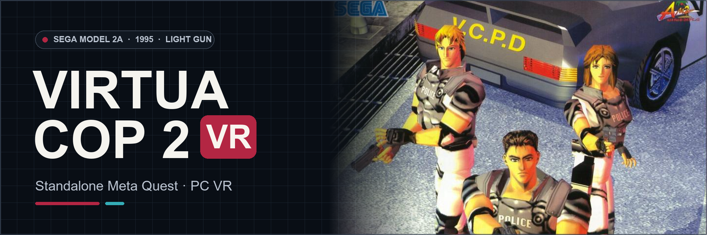

<div align="center">



# Virtua Cop 2 VR
### Sega Model 2A Arcade Light-Gun Action · Standalone Meta Quest & PC VR

[☕ Donate to VR4ALL](https://ko-fi.com/vr4all)

[](https://github.com/vr4all-standalone/vcop2-vr/releases/latest)
[](#installation-meta-quest)
[](#your-game-files)

**[⬇️ Quest APK](https://github.com/vr4all-standalone/vcop2-vr/releases/latest/download/vcop2-vr-quest.apk)** · **[🖥️ PC VR ZIP](https://github.com/vr4all-standalone/vcop2-vr/releases/latest/download/vcop2-vr-pcvr.zip)** · **[🎮 Controls](#controls)**

[Checksums](https://github.com/vr4all-standalone/vcop2-vr/releases/latest/download/SHA256SUMS.txt) · [Complete source](https://github.com/vr4all-standalone/vcop2-vr/releases/latest/download/vcop2-vr-source.zip) · [All releases](https://github.com/vr4all-standalone/vcop2-vr/releases)

**[🌐 VR4ALL — Standalone VR Mod Installer](https://github.com/vr4all-standalone/vr4all-standalone)**

</div>

---

## Update v0.2.12

- Shared wide VR4ALL setup panel, with validated automatic entry and manual Play.
- Full player-colored Arcade body and grip, with original grey screws and lens details. P1 red / P2 blue follow player identity across hand swaps.
- New gun angle 0 matches the old -10-degree pose. Legacy angles reset once; later choices and other settings persist.

## Overview

Experimental port of the original Model 2A arcade game for Quest 3/3S and Windows OpenXR. The native game supplies the scenery, actors, audio and game logic. The VR host adds stereo views, head tracking, tracked guns and the shared purple VR4ALL interface.

This experimental VR port is available as Quest, PCVR and complete-source downloads. Canonical release files are `vcop2-vr-quest.apk`, `vcop2-vr-pcvr.zip`, `vcop2-vr-source.zip` and `SHA256SUMS.txt`. Install the Quest APK with VR4ALL or ADB, then open Virtua Cop 2 VR under Unknown Sources. For PCVR, extract the portable ZIP, enable your OpenXR runtime, connect the headset and run `run-pcvr.cmd`.

Supply your owned `vcop2.zip` and `segabill.zip` in the headset Download folder or PC package `roms/` folder. A complete `vcop2.zip` containing all 31 required payloads also works. No CHD is needed. Setup checks actual sizes, CRC32 and SHA1; no game data is included in the software packages.

## Controls

- A starts or continues P1; X joins P2 after P1 is active. Both native players must acknowledge the join. In dual play the default is P1 left / P2 right; the menu can swap assignments. Solo supports either-hand gun transfer on a fresh trigger pull.
- Triggers fire. B/Y reloads. Button, shoot outside and point outside reload modes are available.
- Menu opens the purple settings panel. It includes Resume, Recenter, gun choice/angle/size, player layout, laser, haptics, world size, panel distance, wider view, view width, Game zoom, How to play, native Service and Quit.
- **Game zoom: Off / On** follows the original camera's automatic zoom-in and zoom-out animations when enabled. Tap and release either grip to toggle it, or use the menu. **Zoom enabled / Zoom disabled** appears in the lower HUD for one second; a later toggle replaces the message and restarts that second. Every new VR launch starts Off, including when an older build saved On. Other preferences remain saved. Hold grip and move the stick to adjust world/gun size; this gesture does not toggle zoom. Head tracking, the original HUD, held guns, controllers and menus retain their own projection. The native flat stage card and Service screens remain unzoomed.
- The three-second focused startup splash clears for the native boot/credits picture, even before the game accepts Start. Real controller models have anchored button labels, including **Grip - Toggle zoom**; How to play shows them again. Stick clicks recenter or toggle the laser; grip plus stick adjusts world/gun size.
- Service uses the original cabinet switches: stick down or B/Y advances; trigger or A/X sends Test to select or exit. Gun calibration changes to actual gun aiming. Right stick click switches back to menu controls when Test is needed. A/X in calibration sends the assigned player's native Start function, which can commit, cancel or adjust values according to the original prompt.
- Gun offers only **In-game gun**, **Arcade**, and **Zapper**. The default In-game gun follows each player's equipped native weapon independently: Rifle, Automatic, Machine Gun, Shot Gun and Magnum pickups appear only while equipped. The standard weapon uses a pistol and hand mesh from the game's character models as a cosmetic; the original standard player's held model has not been established. Models use authored palm/handle pivots at the controller's physical grip position, with the existing aim direction and adjustable gun angle. The physical left-hand model is mirrored, including its embedded hand, regardless of P1/P2 ownership. Older custom/manual pickup settings migrate to In-game gun.
- The original ammo graphics and foreground HUD use their native overlay projection. They remain visible above the hearts when world scenery is nearby. The HUD is excluded from gun aim intersections.

Settings, calibration and NVRAM persist independently from other ports. Native accepted shots drive recoil, muzzle effects and haptics. Aim uses the same surfaces and view lens as stereo drawing. Wider view reveals available original geometry beyond the native crop; it cannot supply scenery absent from the game.

See [validation](docs/validation.md) for exact evidence and remaining physical headset checks.

## Build and verification

Pinned MAME 0.289: `f34f02505e32c1993c6a782b6814232cbfc74e36`. Use a dedicated compiler directory without spaces; the source project itself may contain spaces.

```powershell
python -B tools/game_files.py PATH/TO/vcop2.zip PATH/TO/segabill.zip
python -B -m unittest discover -s tests -v
./tools/build-engine.ps1 -MsysRoot PATH/TO/msys64 -PythonPath PATH/TO/python.exe -WorkEngine D:/Build/vcop2-engine
cmake -S . -B D:/Build/vcop2-host -G Ninja -DCMAKE_BUILD_TYPE=Release
cmake --build D:/Build/vcop2-host
ctest --test-dir D:/Build/vcop2-host --output-on-failure
./tools/build-quest.ps1 -WorkRoot D:/Build/vcop2-quest
```

The Quest build script validates SDK/NDK/JDK/SDL/OpenXR dependencies, compiles ARM64, signs locally and checks APK contents/signature. `-CheckOnly` prints resolved paths. `tools/package.py` creates software-only deliveries and checksums. Engine patches are reconstructed from the pinned source; unknown compiler edits are preserved and rejected.

Diagnostic capture and state tools under `tools/` write only to separate private output directories. Heavy compiler output and private research use this workspace's dedicated D: cache. Existing ports and original game archives are unchanged. See CREDITS.md and licenses/ for component attribution.

## Your game files

Supply your owned vcop2.zip and, unless combined in that ZIP, segabill.zip in `Download/`. Setup verifies the actual ROM lengths, CRC32 and SHA1; no game data is supplied.

## Installation (Meta Quest)

Install the Quest APK, open Virtua Cop 2 VR under Unknown Sources, and allow game-file access. The app checks the files and enters VR automatically when ready.

## Installation (PC VR)

Extract the PCVR ZIP, enable your headset’s OpenXR runtime, place the owned archives in the portable `roms/` folder, and run the supplied PCVR launcher.

## Banner artwork

[Original Sega flyer artwork and banner attribution](docs/github/ARTWORK.md).
